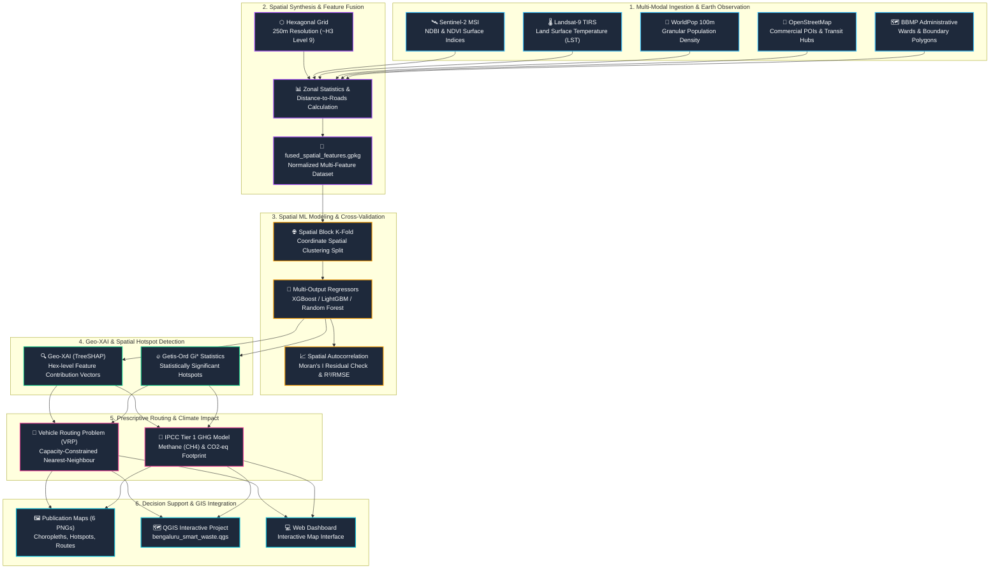

# ♻️ Smart Waste Generation Prediction & Route Optimization (VRP)
### *An End-to-End Geospatial AI System for Municipal Solid Waste Analytics*

[](https://www.python.org/)
[](https://qgis.org/)
[](https://scikit-learn.org/)
[](https://xgboost.readthedocs.io/)
[](https://geopandas.org/)

---

## 📌 Executive Summary

Municipal solid waste (MSW) collection in rapidly expanding metropolises like Bengaluru (BBMP) faces severe inefficiencies due to static scheduling, reactive bin allocation, and lack of spatial granularity. 

This project delivers an end-to-end **Geospatial Intelligence and Prescriptive AI Pipeline** that:
1. **Fuses Multi-Modal Earth Observation & GIS Data** (Sentinel-2, Landsat-9 LST, WorldPop, OSM POIs, Ward Boundaries) onto an equal-area **250m hexagonal spatial grid**.
2. **Predicts Disaggregated Waste Streams** (Total Generation, Biodegradable/Organic %, Recyclable/Dry %) using **Multi-Output Machine Learning** with **Spatial Block K-Fold Cross-Validation** to eliminate spatial autocorrelation leakage.
3. **Explains Geographic Waste Drivers** using **Geo-XAI (TreeSHAP)** and detects statutory clusters via **Getis-Ord $G_i^*$ Hotspot Analysis**.
4. **Optimizes Collection Logistics** using a **Vehicle Routing Problem (VRP)** algorithm to prescribe minimal-mileage truck collection sequences.
5. **Maps Carbon & Methane Footprints** based on IPCC Tier 1 waste degradation factors.

---

## 🏗️ System Architecture Flow



---

## 🔬 Detailed Pipeline Stages

| Stage | Script | Purpose & Key Outputs |
| :--- | :--- | :--- |
| **00** | [`scripts/00_generate_synthetic_data.py`](scripts/00_generate_synthetic_data.py) | Generates and calibrates ward-level waste generation ground truth using BBMP municipal baselines (~5,000–6,000 tonnes/day). |
| **01** | [`scripts/01_spatial_feature_builder.py`](scripts/01_spatial_feature_builder.py) | Generates 250m equal-area hexagonal tessellation, extracts zonal remote sensing metrics (NDBI, NDVI, LST), calculates POI kernel density, and produces `fused_spatial_features.gpkg`. |
| **02** | [`scripts/02_spatial_cv_models.py`](scripts/02_spatial_cv_models.py) | Trains Multi-Output Regressors (XGBoost, LightGBM, Random Forest) via **Spatial Block K-Fold**. Evaluates RMSE, MAE, $R^2$, and checks residuals with Spatial Moran's I. |
| **03** | [`scripts/03_geo_xai_shap.py`](scripts/03_geo_xai_shap.py) | Computes local Shapley values via TreeSHAP to identify dominant waste predictors per cell; runs Getis-Ord $G_i^*$ to delineate 90%, 95%, and 99% confidence hotspots. |
| **04** | [`scripts/04_prescriptive_routing.py`](scripts/04_prescriptive_routing.py) | Formulates a Capacity-Constrained Vehicle Routing Problem (CVRP) for waste collection fleets, outputting optimal truck turn-by-turn routes in `optimized_routes.gpkg`. |
| **05** | [`scripts/05_carbon_impact_calc.py`](scripts/05_carbon_impact_calc.py) | Applies IPCC Tier 1 first-order decay equations to estimate methane ($CH_4$) generation and carbon equivalent emissions ($CO_2\text{-eq}$) per cell and ward. |

---

## 🗺️ Cartographic Visualizations

The automated pipeline generates publication-ready maps under the [`maps/`](maps/) directory:

| Map Output | Description |
| :--- | :--- |
| **`01_predicted_waste_generation.png`** | Sub-ward resolution choropleth map showing total waste generation (kg/day/hex). |
| **`02_getis_ord_hotspots.png`** | Statistical hotspot detection identifying high-risk accumulation zones ($p < 0.01$). |
| **`03_geo_shap_drivers.png`** | Spatial SHAP attribution mapping dominant geographic drivers (Population vs Commercial POIs vs NDBI). |
| **`04_waste_composition_breakdown.png`** | Waste fraction disaggregation (Biodegradable/Organic vs Dry/Recyclable vs Inert). |
| **`05_optimized_collection_routes.png`** | Prescriptive VRP fleet route network with depot allocation and collection sequence. |
| **`06_carbon_methane_heatmap.png`** | IPCC Tier 1 greenhouse gas emissions and methane hazard index. |

---

## 📂 Repository Structure

```text
├── bengaluru_smart_waste.qgs      # Full QGIS Interactive Project
├── run_pipeline.py                # Master CLI Pipeline Runner (Stages 0-5)
├── requirements.txt               # Python package dependencies
├── waste_generation_prediction_plan.md # Theoretical and mathematical specs
├── data/
│   ├── ground_truth/              # Baseline municipal waste data
│   ├── raw/                       # Administrative boundaries, OSM POIs, WorldPop
│   └── processed/                 # GeoPackages (.gpkg) with fused layers & routes
├── maps/                          # High-resolution generated thematic maps
├── report/
│   └── spatial_lab_final_report.md# Formal academic lab report
└── scripts/
    ├── 00_generate_synthetic_data.py
    ├── 01_spatial_feature_builder.py
    ├── 02_spatial_cv_models.py
    ├── 03_geo_xai_shap.py
    ├── 04_prescriptive_routing.py
    ├── 05_carbon_impact_calc.py
    ├── create_qgis_project.py
    └── generate_html_dashboard.py
```

---

## 🚀 Quick Start & Installation

### 1. Clone Repository & Setup Environment
```bash
git clone https://github.com/sribharanitharan/waste-generation-prediction-vrp.git
cd waste-generation-prediction-vrp

# Create virtual environment (optional but recommended)
python -m venv venv
venv\Scripts\activate  # On Windows

# Install dependencies
pip install -r requirements.txt
```

### 2. Run the Complete End-to-End Pipeline
Execute all stages sequentially:
```bash
python run_pipeline.py
```

Or execute specific stages:
```bash
python run_pipeline.py --from 2   # Resume from Stage 2 (Modeling)
python run_pipeline.py --only 4   # Run only Stage 4 (VRP Routing)
```

### 3. Explore in QGIS
1. Launch **QGIS** (3.22+ recommended).
2. Open [`bengaluru_smart_waste.qgs`](bengaluru_smart_waste.qgs).
3. All spatial layers, graduated color ramps, and optimized truck routes are pre-configured with styling rules.

---

## 📊 Study Area Specifications

* **City:** Bengaluru (Bangalore), Karnataka, India
* **Municipal Agency:** Bruhat Bengaluru Mahanagara Palike (BBMP)
* **Spatial Resolution:** 250m Hexagonal Grid (~H3 Resolution 9)
* **Coordinate Reference System:** EPSG:4326 (WGS 84) & Projected UTM 43N (EPSG:32643)

---

## 📜 License
This project is released under the [MIT License](LICENSE).
