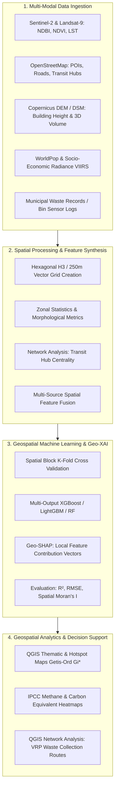

# Implementation Plan: Smart Waste Generation Prediction & Route Optimization Using Geospatial ML

## 1. Project Vision & Research Innovation
This project elevates standard waste volume estimation into an **end-to-end Geospatial Intelligence system** combining multi-spectral satellite remote sensing, 3D urban morphology, multi-output machine learning, Spatial Explainable AI (Geo-XAI), and prescriptive route optimization.

### Key Innovations:
1. **Multi-Stream Waste Disaggregation:** Predicting both total volume and composition breakdown (*Biodegradable/Food, Recyclables/Packaging, Commercial/Inert*).
2. **Earth Observation & 3D Urban Morphology:** Fusing Sentinel-2 (NDBI/NDVI), Landsat-9 Thermal (Land Surface Temperature - LST as an activity proxy), and 3D Building Volume from Digital Surface Models (DSM).
3. **Public Transit & Human Footfall Centrality:** Integrating GTFS/OSM transit hubs with Network Centrality (Betweenness / Closeness) as dynamic footfall indicators.
4. **Spatial Explainable AI (Geo-XAI with Spatial SHAP):** Visualizing which geographic determinants dominate in which wards/grid cells directly on QGIS choropleth maps.
5. **Prescriptive Action - Optimal Bin Siting & VRP Truck Routing:** Linking predicted high-generation zones to QGIS Network Analysis (Traveling Salesperson / Vehicle Routing Problem) for smart collection scheduling.
6. **Carbon & Methane Impact Mapping:** Applying IPCC waste decay factors to map greenhouse gas emission potential ($CH_4 / CO_2$ eq) spatially.

---

## 2. End-to-End System Architecture



---

## 3. Innovative Feature Inventory & Extraction Pipeline

| Dimension | Innovative Feature | Earth Observation / Spatial Source | Extraction Method in QGIS / PyQGIS |
| :--- | :--- | :--- | :--- |
| **Urban Activity Proxy** | **Land Surface Temperature (LST)** | Landsat 8/9 Thermal Band (TIRS Band 10) | Split-Window Algorithm / QGIS SCP Plugin -> `Zonal Statistics (Mean LST)` |
| **Built-up Intensity** | **NDBI & NDVI Ratio** | Sentinel-2 (Band 8 NIR, Band 11 SWIR, Band 4 Red) | QGIS Raster Calculator: `(SWIR - NIR)/(SWIR + NIR)` |
| **3D Urban Volume** | **Building Height & 3D Volume** | Google Open Buildings (Height attributes) or DSM - DTM | Field Calculator: `$area * building_height` aggregated per cell |
| **Transit / Footfall Hubs** | **Transit Network Centrality** | OpenStreetMap (Bus stops, rail stations, metro) | QGIS Network Analysis: Closeness & Betweenness Centrality |
| **Commercial Density** | **Weighted POI Waste Factor** | OpenStreetMap (`amenity`, `shop`) | Kernel Density Estimation (KDE) weighted by commercial waste intensity |
| **Nighttime Radiance** | **Economic Affluence Index** | VIIRS Day/Night Band | Radiance mean per ward/grid cell |
| **Demographics** | **Granular Population Density** | WorldPop 100m constrained layer | Zonal Statistics (`_sum`, `_mean`) |

---

## 4. Methodological Phases & Step-by-Step Implementation

### Phase 1: Spatial Grid & Environmental Feature Engineering (QGIS)
1. **Spatial Unit Construction:**
   - Generate an equal-area **Hexagonal Grid (H3 / 250m-500m diameter)** using `Processing Toolbox -> Vector Creation -> Create Grid (Hexagon)`.
   - Clip grid strictly to the Municipal Corporation boundary.
2. **Remote Sensing Index Extraction:**
   - Compute **NDBI (Normalized Difference Built-up Index)** and **NDVI** on cloud-free Sentinel-2 imagery.
   - Run `Raster Analysis -> Zonal Statistics` to append mean NDBI, mean NDVI, and vegetation-to-concrete ratios to each hexagon.
3. **LST Calculation (Urban Heat proxy):**
   - Extract thermal radiance from Landsat-9 TIRS, convert to Brightness Temperature in Celsius, and aggregate mean LST per cell.
4. **POIs & Weighted Waste Score:**
   - Assign empirical waste generation weights to POIs (e.g., Food market: 5x, Supermarket: 3x, Office: 1.5x, Park: 0.5x).
   - Compute the weighted POI density per hexagon using `Count Points in Polygon` or `Kernel Density Estimation`.

### Phase 2: Disaggregated Multi-Output Machine Learning
1. **Target Formulation:**
   - Target $Y_1$: Total Waste Generation ($\text{kg}/\text{day}$).
   - Target $Y_2$: Biodegradable / Organic Fraction (%).
   - Target $Y_3$: Recyclables / Dry Fraction (%).
2. **Modeling Algorithms:**
   - **MultiOutputRegressor with XGBoost / LightGBM:** High predictive accuracy on non-linear spatial interactions.
   - **Random Forest Regressor:** Robust against multicollinearity between spatial indices.
   - **Geographically Weighted Regression (GWR):** Benchmark model to observe spatial non-stationarity across neighborhoods.
3. **Spatial Cross-Validation (Spatial Block K-Fold):**
   - Prevent spatial leakage by partitioning folds using spatial clustering (`KMeans` on centroid coordinates $(X, Y)$) instead of standard random splits.
4. **Spatial Autocorrelation Diagnostics:**
   - Compute **Global Moran's I** on model residuals to verify that errors are spatially independent and un-clustered.

### Phase 3: Spatial Explainable AI (Geo-XAI via SHAP)
1. **Local Feature Attribution:**
   - Calculate TreeSHAP values for each grid cell across all features.
2. **Mapping Primary Driving Factors in QGIS:**
   - Identify the `#1 dominant driver` for each cell (e.g., *Is waste in Cell 104 driven primarily by Restaurant Density or Residential Population?*).
   - Export dominant driver labels and SHAP importance values back to the GeoPackage layer.
   - Render a categorical map in QGIS showing local drivers across the city.

### Phase 4: Prescriptive Analytics & Smart Truck Routing (QGIS Network Analysis)
1. **Hotspot Classification:**
   - Run `Processing -> Vector Analysis -> Spatial Autocorrelation (Getis-Ord Gi*)` on predicted waste volumes to isolate statistically significant $90\%$, $95\%$, and $99\%$ confidence hotspots.
2. **Bin Capacity & Sensor Siting Optimization:**
   - Identify top $15\%$ under-served grid cells needing smart sensor bins or secondary transfer points.
3. **Optimized Vehicle Routing (VRP):**
   - Build a road network topology using OSM road layers.
   - Execute QGIS Network Analysis (`Shortest Path (Layer to Point)` or `QNEAT3` plugin) to determine optimal waste truck dispatch paths prioritizing high-accumulation zones while minimizing fuel travel distance.

### Phase 5: Environmental & Climate Impact Modeling
1. **Methane Potential Estimation ($CH_4$ eq):**
   - Apply IPCC Tier 1 solid waste methodology:
     $$CH_4 \text{ Potential} = \text{Organic Waste (tons)} \times \text{DOC} \times \text{DOC}_f \times F \times \frac{16}{12}$$
   - Map greenhouse gas emission potential per square kilometer.

---

## 5. Lab Deliverables & Map Portfolio

For a top-tier lab project report and viva presentation, produce this 6-panel map series in QGIS Print Layout:

1. **Map 1: Input Multi-Spectral & Urban Covariates** (NDBI, LST, and Population Density).
2. **Map 2: Predicted Waste Generation Density** (Graduated choropleth with Natural Breaks / Jenks).
3. **Map 3: Waste Stream Composition Breakdown** (Pie chart diagrams overlaid on ward centroids).
4. **Map 4: Getis-Ord $G_i^*$ Hotspot & Coldspot Clusters** (Statistical confidence map).
5. **Map 5: Geo-SHAP Dominant Drivers** (Categorical map indicating which factor drives waste per zone).
6. **Map 6: Prescriptive Collection Routes** (Optimized truck trajectories traversing identified high-waste nodes).

---

## 6. Directory Structure

```text
Spatial/
├── data/
│   ├── raw/
│   │   ├── boundary.geojson
│   │   ├── sentinel2_indices/          # NDBI, NDVI GeoTIFFs
│   │   ├── landsat_lst/                # Land Surface Temperature GeoTIFF
│   │   ├── worldpop.tif
│   │   └── osm_pois.gpkg
│   ├── processed/
│   │   ├── hex_grid_250m.gpkg          # Base spatial analysis units
│   │   └── fused_spatial_features.gpkg # Complete engineered matrix
│   └── ground_truth/
│       └── municipal_waste_data.csv
├── scripts/
│   ├── 01_spatial_feature_builder.py   # Automated PyQGIS feature extraction
│   ├── 02_spatial_cv_models.py         # Multi-output ML with Spatial Block K-Fold
│   ├── 03_geo_xai_shap.py              # Spatial SHAP computation & dominant driver mapping
│   ├── 04_prescriptive_routing.py      # QGIS network routing for waste trucks
│   └── 05_carbon_impact_calc.py        # IPCC greenhouse gas spatial translation
├── maps/
│   ├── 01_predicted_waste_generation.png
│   ├── 02_getis_ord_hotspots.png
│   ├── 03_geo_shap_drivers.png
│   └── 04_optimized_collection_routes.png
└── report/
    └── spatial_lab_final_report.md
```

---

## 7. Python Implementation Preview (Spatial-SHAP & Multi-Output ML)

```python
import geopandas as gpd
import numpy as np
import shap
from sklearn.ensemble import RandomForestRegressor
from sklearn.cluster import KMeans
from sklearn.metrics import r2_score, mean_squared_error

# 1. Load fused spatial features from QGIS
gdf = gpd.read_file("data/processed/fused_spatial_features.gpkg")

features = [
    'pop_density', 'mean_ndbi', 'mean_lst', 'building_vol_m3',
    'weighted_poi_density', 'transit_centrality', 'road_density'
]
target = 'total_waste_kg_day'

X = gdf[features].fillna(0)
y = gdf[target]

# 2. Spatial Block Partitioning (Spatial K-Fold)
coords = np.column_stack([gdf.geometry.centroid.x, gdf.geometry.centroid.y])
spatial_clusters = KMeans(n_clusters=5, random_state=42).fit_predict(coords)
gdf['spatial_fold'] = spatial_clusters

# 3. Train ML Model
model = RandomForestRegressor(n_estimators=150, max_depth=12, random_state=42)
model.fit(X, y)
gdf['pred_waste_kg_day'] = model.predict(X)

# 4. Compute Geo-XAI (Spatial SHAP)
explainer = shap.TreeExplainer(model)
shap_values = explainer.shap_values(X)

# Identify dominant local driver for each spatial cell
dominant_driver_idx = np.argmax(np.abs(shap_values), axis=1)
gdf['primary_driver'] = [features[i] for i in dominant_driver_idx]

# 5. Export enriched GeoPackage directly back to QGIS
gdf.to_file("data/processed/final_predictions_with_shap.gpkg", driver="GPKG")
print("Exported spatial layer with predictions and Geo-SHAP drivers for QGIS visualization!")
```
